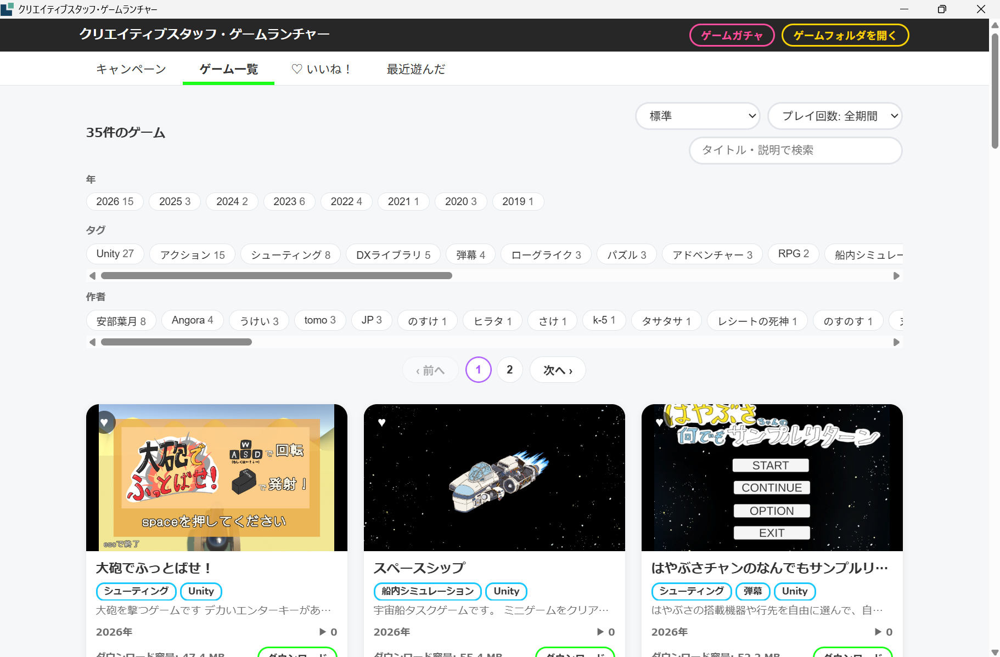
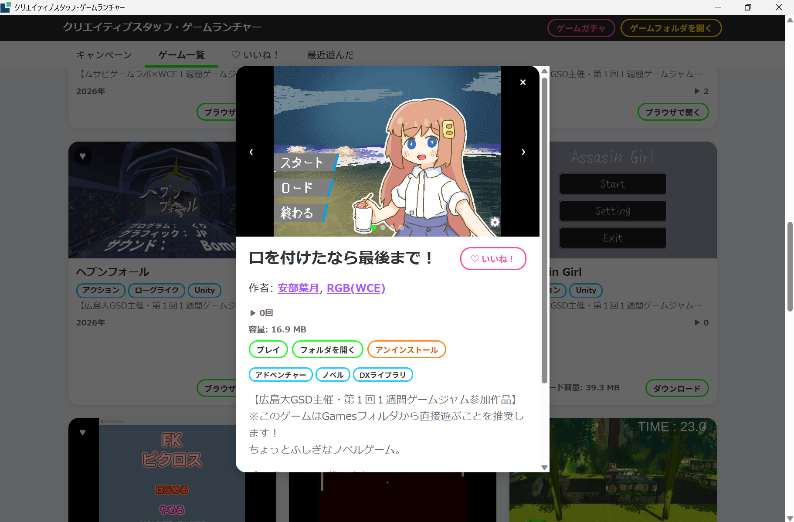
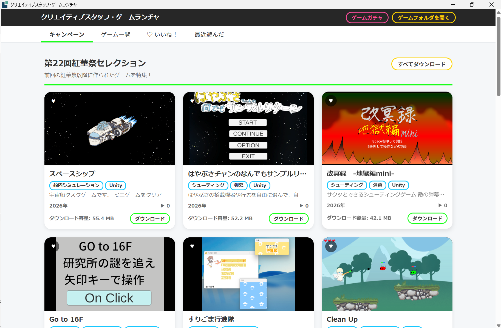
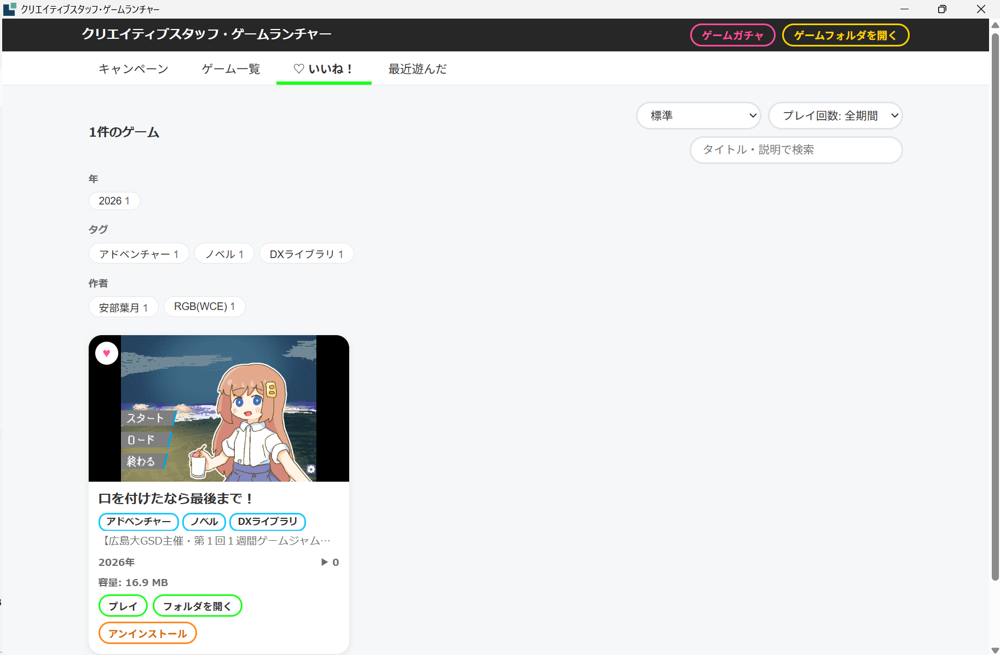
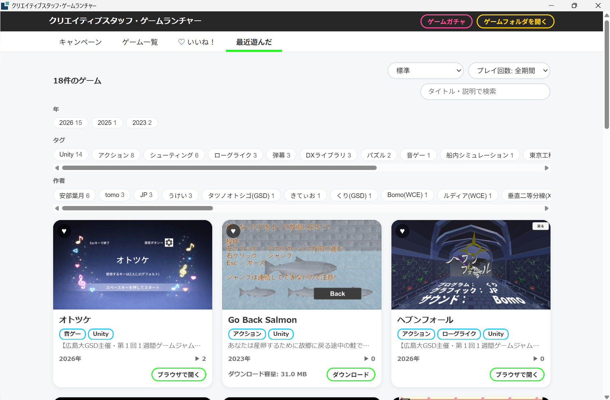
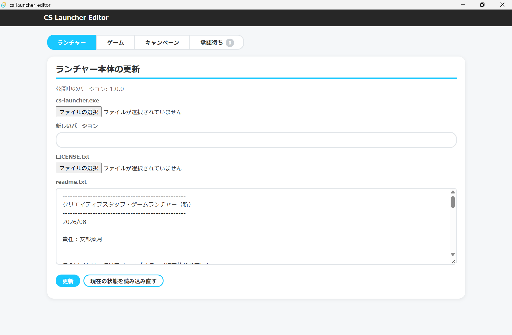
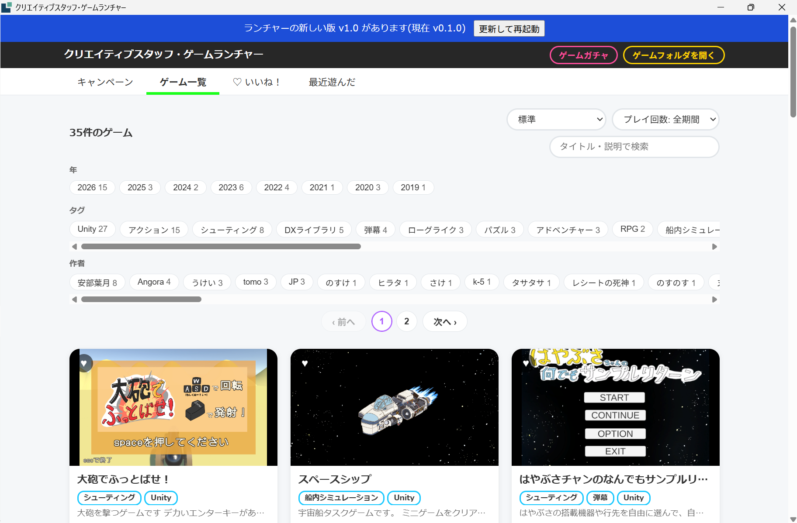

# 概要

　弊サークル・東京工科大クリエイティブスタッフで開発しているゲームランチャーです  
　配布は[ホームページ](https://www.creative-staff.com/games/games.html)で行っているほか、アップデートが入ると本体側に更新のお知らせが出ます

# 各画面に関して

## ゲーム一覧
　クリエイティブスタッフの部員が製作したゲームがプレイできます  
　プレイ回数、作者、タグ、投稿日などでソート・並び変えできます 

  

 

### ゲームの詳細表示
　説明文や制作者、タグのほか、お気に入りボタン、プレイメモなど

  

 

## キャンペーン
　サークル内での特集を表示します  
　文化祭やコミックマーケットの度に更新すると思われます

  

 

## お気に入り、最近遊んだゲーム
　名の通りです

  
  

 

# 更新方法（開発者向け）

　ランチャーの更新はcs-launcher-editor（サークル内でのみ公開）で行います  
　src-tauri/Cargo.tomlのバージョンとreadme.txtを変更し、依存関係が増えた場合はLICENSE.txtも更新してください  
　ホームページで公開しているランチャーのzipも自動で更新されます  
　また、Cargo.tomlのバージョンとエディターに入力するバージョンは合わせてください（合わせないと更新してもランチャー側で通知が出続けます）  
　あと、Cargo.tomlのバージョンは1.0.0のような３つの数字の連なったものでなければビルド時にエラーが出るのでご注意ください  

  
  

 

　また、ゲーム・キャンペーンの更新もエディターで行います  
　そちらに関してはサークル内の掲示とかをご覧ください